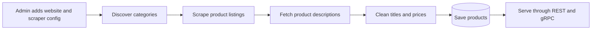
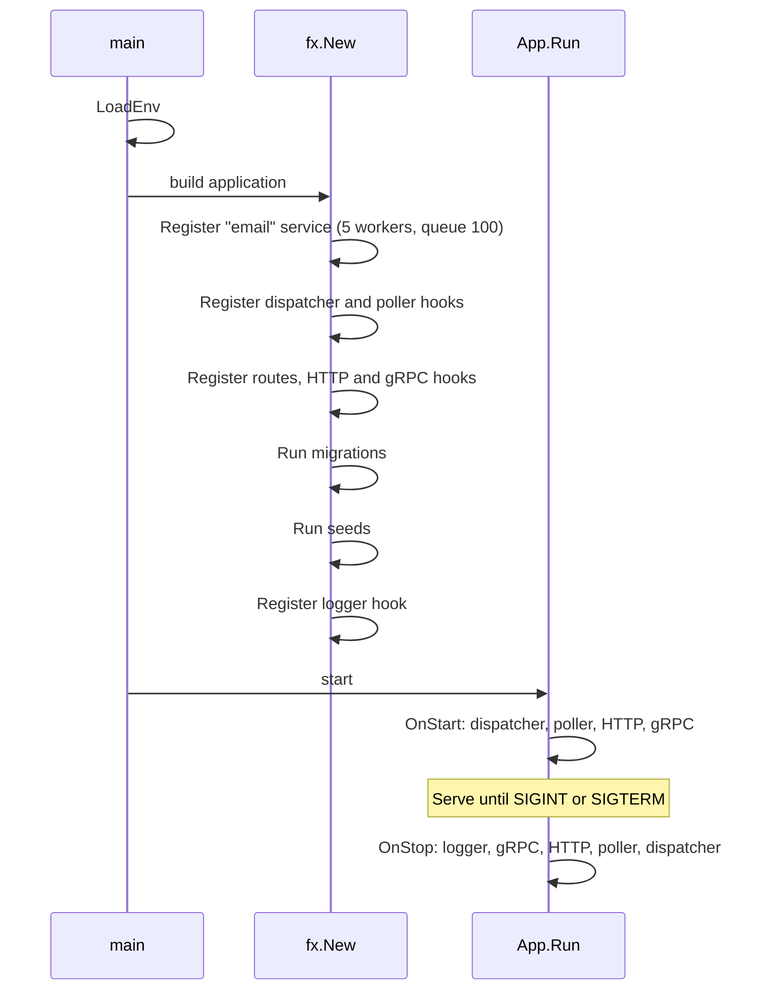
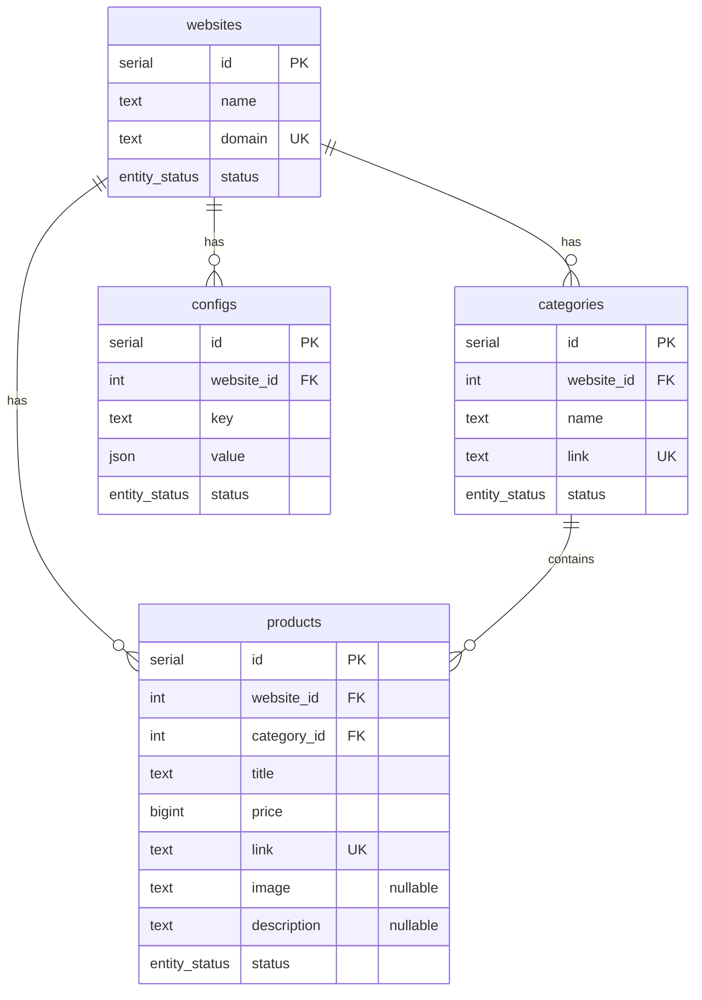
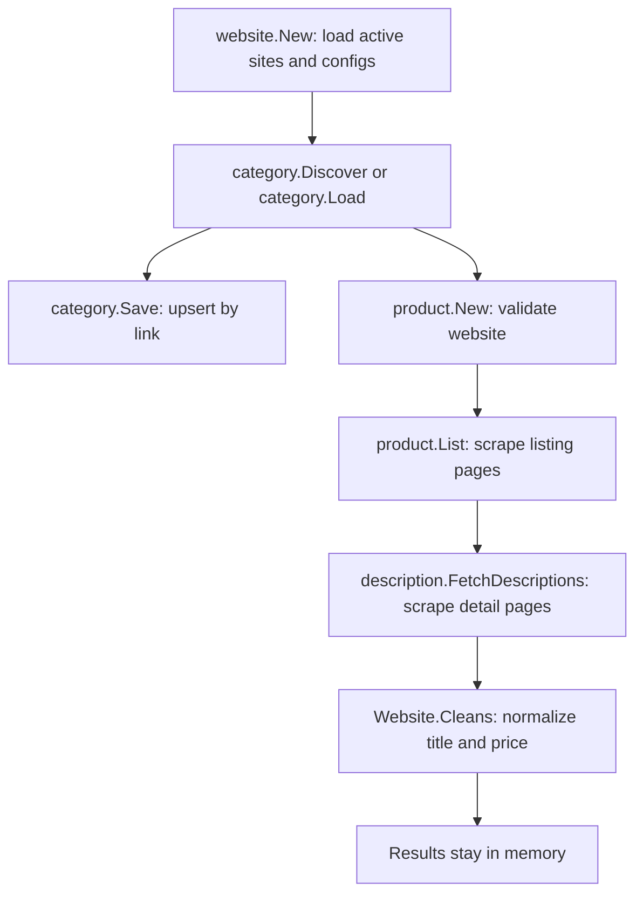
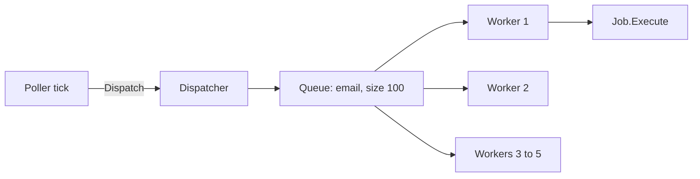

# go-wordpress: Implementation Guide

This document explains how the project is built, how each part works, and what is still unfinished or broken. It reflects commit `bb917fb` (2026-11-08).

## Contents

1. [What the project is](#1-what-the-project-is)
2. [Current status](#2-current-status)
3. [Technology stack](#3-technology-stack)
4. [Repository layout](#4-repository-layout)
5. [Application startup and shutdown](#5-application-startup-and-shutdown)
6. [Configuration](#6-configuration)
7. [Data model](#7-data-model)
8. [Migrations and seeds](#8-migrations-and-seeds)
9. [SQL access with sqlc](#9-sql-access-with-sqlc)
10. [Redis cache](#10-redis-cache)
11. [HTTP API](#11-http-api)
12. [Authentication](#12-authentication)
13. [gRPC API](#13-grpc-api)
14. [Crawler](#14-crawler)
15. [Background jobs: poller, dispatcher, workers](#15-background-jobs-poller-dispatcher-workers)
16. [Logging and error handling](#16-logging-and-error-handling)
17. [Testing](#17-testing)
18. [Build, run, and tooling](#18-build-run-and-tooling)
19. [Known issues](#19-known-issues)
20. [Suggested next steps](#20-suggested-next-steps)

---

## 1. What the project is

go-wordpress is a Go backend for collecting product catalogs from online shops, mainly Persian-language WordPress/WooCommerce stores. It has two halves:

- **An admin service** with JWT-protected REST CRUD for websites, categories, products, and scraper configs, plus a small gRPC API for products.
- **A configurable crawler** built on [Colly](https://go-colly.org/). CSS selectors are stored per website in the database, so a new shop can be added without code changes.

A third component, a **poller and worker pool**, exists to run background work. It currently only runs a placeholder job.

The intended flow is:



Only part of this flow is connected today. See the next section.

## 2. Current status

| Area | Status | Notes |
|---|---|---|
| REST CRUD (websites, categories, products, configs) | Working | Covered by end-to-end tests |
| Health check and Swagger UI | Working | |
| Redis read-through cache | Working | Has invalidation gaps ([§19](#19-known-issues)) |
| Migrations and seeding at startup | Working | Skipped when `APP_ENV=test` |
| Category discovery and saving | Implemented | Only ever called from tests |
| Product list scraping, description fetching, cleaning | Implemented | Not called from anywhere, including tests |
| **Saving scraped products** | **Missing** | No upsert query or save method exists |
| **Scheduling crawls** | **Missing** | The crawler is not registered in the Fx app |
| gRPC | Partial | 1 of 5 RPCs implemented, and it can crash the server |
| Poller and workers | Skeleton | Infrastructure is real; the job is a 1-second sleep |
| Login endpoint | Missing | Tokens can only be generated by calling `auth.GenerateToken` in code |
| Docker image | Broken | The Dockerfile builds a path that does not exist |

## 3. Technology stack

| Concern | Library | Version |
|---|---|---|
| Language | Go | 1.27 |
| Dependency injection and lifecycle | `go.uber.org/fx` | 1.24.0 |
| HTTP | `gin-gonic/gin`, `gin-contrib/timeout` | 1.10.1, 1.1.0 |
| RPC | `google.golang.org/grpc`, protobuf | 1.76.0, 1.36.10 |
| Database | PostgreSQL via `lib/pq` | 1.10.9 |
| Query generation | sqlc | 1.30.0 |
| Migrations | `golang-migrate/migrate/v4` | 4.19.0 |
| Cache | Redis via `redis/go-redis/v9` | 9.14.0 |
| Crawling | `gocolly/colly/v2` | 2.3.0 |
| Authentication | `golang-jwt/jwt/v5` | 5.3.0 |
| Configuration | `spf13/viper`, `joho/godotenv` | 1.21.0, 1.5.1 |
| Logging | `go.uber.org/zap` and the standard `log` package | 1.27.0 |
| API docs | `swaggo/swag`, `gin-swagger` | 1.16.6, 1.6.0 |
| Test assertions | `stretchr/testify` | 1.11.1 |

## 4. Repository layout

```text
cmd/server/main.go            Entry point: load env, run the Fx app
api/proto/product/v1/         Protobuf definition and generated gRPC code
docs/                         Generated Swagger files (do not edit by hand)
pkg/logger/                   Zap logger constructor and flush-on-stop hook
test/                         End-to-end tests and config validation tests

internal/
  app/                        Fx wiring: the one place that lists every component
  config/                     Environment loading and validation
  server/                     Gin engine, HTTP server, gRPC server, route table
  middleware/                 JWT check
  auth/                       JWT creation
  health/                     GET /health
  http/response/              Shared JSON error helper
  shared/                     Pagination DTO

  website/ category/          Admin modules, each with controller/, service/, dto/
  product/ configs/

  crawler/
    domain/                   Website, Category, Product, CFG types; data cleaning
    website/                  Loads active websites and their configs from the DB
    category/                 Discovers, saves, and loads categories
    product/                  Scrapes listing pages
    description/              Scrapes product detail pages

  poller/                     Periodic tick loop
    dispatcher/               One queue and worker pool per named service
    worker/                   Worker goroutines
    job/                      Job interface
  example/                    Placeholder job

  storage/
    cache/                    Redis client, typed key helpers, get/set/delete
    sql/
      client.go               Opens the Postgres connection
      migrate/                Migration runner and custom seeder
      migrations/             Versioned schema (up migrations only)
      seeds/                  Initial websites and scraper configs
      sqlc/                   Hand-written schema/ and queries/, generated Go
```

Each admin module follows the same layering:

```text
controller (HTTP binding, status codes) → service (cache plus business logic) → sqlc.Queries (SQL)
```

The README describes this as Clean Architecture, but the separation is lighter than that. Controllers bind HTTP bodies directly into sqlc-generated structs, and services depend on the concrete `*sqlc.Queries` and `*cache.Store` types rather than interfaces. This keeps the code short, but it means database types are the public API shape and services cannot be unit-tested with mocks.

## 5. Application startup and shutdown

[`cmd/server/main.go`](cmd/server/main.go) does two things: `config.LoadEnv()` and `app.NewApp().Run()`. All wiring is in [`internal/app/app.go`](internal/app/app.go).

Fx separates three kinds of step:

- **`fx.Provide`** registers constructors. They run lazily, only when something needs their result.
- **`fx.Invoke`** functions run once, in order, during `fx.New`.
- **Lifecycle hooks** registered by those invokes run later: `OnStart` in registration order, `OnStop` in reverse.



Key consequences:

- Migrations and seeds finish **before** any server starts accepting traffic, because invokes run before `OnStart` hooks.
- On shutdown, gRPC and HTTP stop first, then the poller, then the dispatcher, so nothing dispatches into closed queues.
- HTTP shutdown waits up to 5 seconds ([`http.go:53`](internal/server/http.go#L53)). gRPC uses `GracefulStop` with no deadline of its own.

## 6. Configuration

### Loading

`LoadEnv` ([`config.go:86`](internal/config/config.go#L86)) reads `APP_ENV`, defaulting to `development`, then loads the **first** file that exists from:

1. `.env.<env>`
2. `.env`
3. `../.env.<env>`
4. `../.env`

Files are not merged, and `godotenv` never overrides variables already set in the process environment. `NewConfig` then reads variables through Viper with the `APP` prefix and validates them.

### Variables

All are required. Validation stops at the first failure and the application does not start.

| Variable | Dev value | Rule |
|---|---|---|
| `APP_HTTP_PORT` | `4000` | 1–65535, different from the gRPC port |
| `APP_HTTP_ADDRESS` | `127.0.0.1` | IP address or `localhost` |
| `APP_GRPC_PORT` | `9001` | 1–65535 |
| `APP_ENV` | `development` | `development`, `test`, or `production` |
| `APP_DATABASE_DSN` | local Postgres URL | Prefix `postgres://`, `postgresql://`, or `mysql://` |
| `APP_JWT_SECRET` | set in the env file | Non-empty; under 32 characters logs a warning |
| `APP_JWT_EXPIRY_HOURS` | `72` | Above 0; above 720 logs a warning |
| `APP_REDIS_DSN` | `localhost:6379` | Must look like `host:port` |
| `APP_REDIS_DB` | `0` | 0–15 |
| `APP_REDIS_PREFIX` | `go-wordpress` | Non-empty, no spaces |
| `APP_REDIS_DEFAULT_TTL` | `5` | Minutes, above 0 |

In production mode, `validateWarnings` also logs warnings for a default JWT secret, a `127.0.0.1` HTTP address, and `localhost` database or Redis hosts.

`APP_HTTP_ADDRESS` only sets the host shown in Swagger. The servers always bind all interfaces (`:<port>`).

## 7. Data model



Details that apply across tables:

- `entity_status` is a Postgres enum: `active`, `inactive`, `in_progress`. It defaults to `active`.
- Every table has `created_at` and `updated_at`. Queries set `updated_at` explicitly; there are no triggers.
- All foreign keys use `ON DELETE CASCADE`, so deleting a website removes its categories, products, and configs.
- Every foreign key except `configs.website_id` has an index, and every table has an index on `status`.
- `categories.link` and `products.link` are unique across the whole table, not per website.
- `configs` has no uniqueness constraint on `(website_id, key)`, so several rows can share a key. The crawler uses the newest.
- `price` is an integer in the site's currency unit, which is toman for the current seed sites.

## 8. Migrations and seeds

### Migrations

`migrate.Runner` applies `internal/storage/sql/migrations/*.up.sql` with golang-migrate. Any failure stops the process. There are four migrations, one per table, and no down migrations.

The sqlc schema files in `sqlc/schema/` duplicate these tables by hand. They currently match, apart from the `DROP TYPE` at the top of migration 0001, and any future schema change must be made in both places.

### Seeds

golang-migrate does not handle seed data, so [`seeder.go`](internal/storage/sql/migrate/seeder.go) implements it:

1. Create a `seed_history` table if needed.
2. Read `internal/storage/sql/seeds/*.sql` in filename order.
3. Skip any file already listed in `seed_history`.
4. Run each new file and record it in one transaction.

Two sites are seeded: `hosseinibrothers.ir` and `badomjip.com`. [`wordpress-websites.md`](wordpress-websites.md) lists seven candidates.

Both migrations and seeds are skipped when `APP_ENV=test`. Both use paths relative to the working directory, so the app must run from the repository root.

## 9. SQL access with sqlc

`sqlc.yaml` generates type-safe Go from the 40 named queries in `internal/storage/sql/sqlc/queries/`. `sql.InitialDB` returns the connection as `sqlc.DBTX`, and Fx passes that to `sqlc.New`. `Queries.WithTx` is available, but no code uses transactions through it.

To change a query, edit the `.sql` file and run `sqlc generate`.

The `sqlc.yaml` config does not enable JSON tags, which has a visible effect on the API because generated structs are used as request and response bodies:

- JSON keys are the Go field names: `WebsiteID`, `CreatedAt`, and so on.
- `sql.NullString` columns serialize as objects.

```json
{
  "WebsiteID": 1,
  "CategoryID": 1,
  "Title": "Example",
  "Price": 499000,
  "Link": "https://example.com/p/1",
  "Image": { "String": "https://example.com/1.jpg", "Valid": true },
  "Description": { "String": "", "Valid": false },
  "Status": "active"
}
```

## 10. Redis cache

[`cache.Store`](internal/storage/cache/store.go) wraps go-redis with JSON `Set`, `Get`, `Delete`, and `Exists`. TTLs are in minutes.

### Keys

`<prefix>` comes from `APP_REDIS_PREFIX`.

| Entity | Single item | List page |
|---|---|---|
| Product | `<prefix>:product:<id>` | `<prefix>:products:all:<limit>:<offset>` |
| Website | `<prefix>:website:<id>` | `<prefix>:websites:all:<limit>:<offset>` |
| Category | `<prefix>:category:<id>` | `<prefix>:categories:all:<limit>:<offset>` |
| Config | `<prefix>:config:<id>` | `<prefix>:configs:all:<limit>:<offset>` |

### Strategy

All four services use the same pattern:

| Operation | Behavior |
|---|---|
| Get by ID | Try the cache. On any cache error, read the database and store the result. |
| List | Same, keyed by limit and offset. |
| Create, Update | Write to the database, cache the returned row, delete all list pages for that entity. |
| Delete | Delete the cached item and list pages, then delete from the database. |

List pages are removed with `SCAN` and a key pattern, which avoids blocking Redis the way `KEYS` would.

Cache write failures are ignored, so a Redis outage falls back to the database. Each request still pays the cost of the failed Redis calls.

## 11. HTTP API

### Global middleware

`gin.Logger`, `gin.Recovery`, and a 60-second timeout apply to every route ([`http.go:25`](internal/server/http.go#L25)). Unknown routes return a JSON 404.

### Routes

| Method | Path | Auth | Purpose |
|---|---|---|---|
| GET | `/health` | No | Liveness; returns `{"message":"OK"}` and does not check dependencies |
| GET | `/swagger/*any` | No | Swagger UI |

Each of `products`, `websites`, `categories`, and `configs` has the same five routes under `/api/v1/admin/<resource>`, all requiring a Bearer token:

| Method | Path | Success |
|---|---|---|
| POST | `/` | 201 with the created row |
| GET | `/` | 200 with an array; accepts `?limit=` (default 10) and `?offset=` (default 0) |
| GET | `/:id` | 200 with the row |
| PUT | `/:id` | 200 with the updated row |
| DELETE | `/:id` | 204 |

Collection routes are registered with a trailing slash. Requests without one get a redirect from Gin (307 for POST, 301 for GET), which matters for clients that don't follow redirects, such as `curl` without `-L`.

### Request fields

| Resource | Create | Update adds |
|---|---|---|
| Website | `Name`, `Domain` | `Status` |
| Category | `WebsiteID`, `Name`, `Link` | `Status` |
| Product | `WebsiteID`, `CategoryID`, `Title`, `Price`, `Link`, `Image`, `Description`, `Status` | nothing |
| Config | `WebsiteID`, `Key`, `Value` (any JSON) | `Status` |

PUT is a full replacement. Omitted fields become zero values, and an empty `Status` is rejected by Postgres because it is not a valid enum value.

### Error responses

Errors use `{"error":"<message>"}` and are logged as JSON.

| Situation | Status |
|---|---|
| Missing or invalid token | 401 |
| Non-numeric ID, malformed JSON, invalid pagination type | 400 |
| Anything from the service layer, including row not found and unique violations | 500 |

### Regenerating Swagger

Swagger comes from `godoc` annotations on the controllers:

```bash
swag init --parseDependency --parseInternal -g cmd/server/main.go
```

## 12. Authentication

- [`auth.GenerateToken`](internal/auth/token.go) creates an HS256 token with `admin_id` and `exp` claims.
- [`middleware.JWTAuth`](internal/middleware/jwt.go) checks for `Authorization: Bearer <token>`, verifies the signature and expiry, and rejects anything else with 401.

The middleware is attached per route in each controller's `RegisterRoutes`. It does not read `admin_id` or set it on the request context, so any valid token has full admin access.

There is no login endpoint or admin user table. The practical way to get a token during development is:

```bash
go test ./test -run TestJWTTokenCreator -v
```

This needs Postgres and Redis running and boots the app in test mode. The printed token is signed with the secret from `.env.test`, so it only works against a server using that same secret.

## 13. gRPC API

The contract is in [`product.proto`](api/proto/product/v1/product.proto). The server listens on `APP_GRPC_PORT` with no TLS, authentication, or interceptors.

| RPC | State |
|---|---|
| `GetProductByID` | Implemented; only `Id` is filled in the response |
| `CreateProduct`, `UpdateProduct`, `DeleteProduct`, `ListProducts` | Return `Unimplemented` through the embedded base server |

The proto messages use `name`, `description`, `price`, and `is_active`, while the database uses `title`, nullable `description`, `price`, `status`, and two foreign keys. Finishing the API will require a mapping or a change to the contract.

Regenerate code with the `protoc` command in the README.

## 14. Crawler

The crawler is in `internal/crawler/`. Its behavior is driven by the JSON stored in `configs.value` where `key = 'scraper_config'`.

### Scraper config

```json
{
  "start_url": "https://badomjip.com/",
  "product_list": {
    "item": "div.product-grid-item",
    "fields": {
      "title": { "selector": "h3.wd-entities-title a", "attr": "" },
      "price": { "selector": "span.price", "attr": "" },
      "link":  { "selector": "a.product-image-link", "attr": "href" },
      "image": { "selector": "a.product-image-link img", "attr": "src" }
    }
  },
  "pagination": { "next": "a.next.page-numbers" },
  "product_detail": {
    "description": {
      "selector": "div.woocommerce-product-details__short-description, div.woocommerce-Tabs-panel--description"
    }
  }
}
```

| Field | Meaning |
|---|---|
| `start_url` | Page used for category discovery |
| `product_list.item` | Selector for one product card |
| `product_list.fields` | Selector within the card. `title` and `price` use text content; `link` and `image` read the attribute named in `attr` |
| `pagination.next` | Optional selector for the next-page link |
| `product_detail.description` | Selector on the product page |

### Pipeline



### Steps

**1. Load websites** ([`website/service.go`](internal/crawler/website/service.go)). `website.New` runs immediately on construction. It reads up to 1000 active websites and their active configs, keeps the newest valid `scraper_config` for each, and skips any website without one, logging a warning.

**2. Discover categories** ([`category/service.go`](internal/crawler/category/service.go)). Visits only `start_url`, collecting links from `nav a[href]` and from `a.category-link`, `div.product-category a`, and `.category-menu a`. `isValidLink` rejects:

- External hosts
- The site root
- Paths starting with `/login`, `/register`, `/account`, `/cart`, `/checkout`, `/admin`, `/blog`, `/contact-us`, `/about-us`, `/content`, or `/product/`
- Persian registration form URLs
- `javascript:`, `mailto:`, and `tel:` links
- URLs with fragments

**3. Save or load categories.** `Save` uses `UpsertCategory`, conflicting on `link` and updating only `name`. An admin's `inactive` status therefore survives re-crawls. `Load` reads the active categories for a website instead of crawling again.

**4. Scrape listings** ([`product/service.go`](internal/crawler/product/service.go)). Each category gets a new asynchronous collector with up to 4 parallel requests and a 500 ms delay. Cards without a link are dropped. Pagination links are followed when configured. A category whose first request can't be started is logged and skipped.

**5. Fetch descriptions** ([`description/service.go`](internal/crawler/description/service.go)). Products are processed 4 at a time per category, with a new collector per batch, 4 parallel requests, an 800 ms delay, a 30-second timeout, and a 2-second pause after each batch. A failed page is logged and leaves that product's description empty.

**6. Clean** ([`domain/cleanup.go`](internal/crawler/domain/cleanup.go)). Strips HTML from titles. For prices, it removes `تومان` and commas, converts Persian digits to ASCII, removes all remaining non-digits, and parses an integer. Results go in `Category.CleanedProducts`. A price that can't be parsed becomes `0`.

### Where it stops today

`product.Service` holds a `query` field but has no save method, and `product.sql` has no upsert. `CleanedProducts` is never written anywhere. Nothing in `app.go` constructs a crawler service. `crawler.New` in [`crawler/service.go`](internal/crawler/service.go) is unused.

To use these services from code, construct them per website, passing a pointer because results are stored on the `Website`:

```go
web := &websites.Websites[i]

cat, _ := category.New(logger, query, web)
_ = cat.Discover()      // or cat.Load(ctx)
_ = cat.Save(ctx)

prod, _ := product.New(logger, query, web) // requires categories to be loaded
_ = prod.Run()                             // list, descriptions, clean
```

## 15. Background jobs: poller, dispatcher, workers



| Component | Behavior |
|---|---|
| **Job** ([`job.go`](internal/poller/job/job.go)) | Interface with `ID()`, `Service()`, and `Execute(ctx)` |
| **Dispatcher** ([`dispatcher.go`](internal/poller/dispatcher/dispatcher.go)) | Keeps one buffered channel and worker pool per service name, and routes jobs by `Job.Service()` |
| **Worker** ([`simple.go`](internal/poller/worker/simple.go)) | Goroutine that reads the queue, runs jobs, and logs errors without stopping |
| **Poller** ([`poller.go`](internal/poller/poller.go)) | Ticker that calls the replaceable `OnTick` function |

`Dispatch` blocks when a queue is full, providing backpressure. It returns `ErrServiceNotRegistered` for unknown services and `context.Canceled` after stop.

The dispatcher's shutdown avoids a send-on-closed-channel panic. `Dispatch` holds a read lock during the send, and `Stop` cancels the context **before** taking the write lock, which wakes any blocked senders so the lock can be acquired. `TestDispatcher_StopDuringConcurrentDispatch` covers this.

There are no retries, persistence, or job status tracking.

Today only an `email` service is registered, and the default tick dispatches an `example.ExampleJob` that sleeps for one second. To add real work:

1. Implement `job.Job`.
2. Register its service in `dispatcher.RegisterServices`.
3. Replace `Poller.DefaultTick` and `conditionMet` with real logic.
4. Set `Interval` to a realistic value.

## 16. Logging and error handling

Logging is mixed:

- **Zap** (JSON to stdout): crawler and injected into services.
- **Standard `log` and `fmt.Println`**: startup, servers, dispatcher, poller, and `response.JSONError`.
- **`gin.Logger`**: HTTP access logs in text format.

Failures fall into three groups:

- Startup failures in config validation, migrations, or seeds stop the process.
- Request failures are returned as JSON and logged.
- Crawler failures for individual pages are logged and skipped.

## 17. Testing

There are 39 top-level test functions.

| Location | Count | Type | Requires |
|---|---|---|---|
| `internal/poller/...` | 12 | Unit and concurrency tests | Nothing |
| `test/load_env_test.go` | 18 | `ValidateConfig` rules | Nothing |
| `test/*_admin_test.go` | 4 (with subtests) | End-to-end CRUD and 401 checks | Postgres, Redis |
| `test/http_server_test.go`, `generate_key_test.go`, `product_grpc_test.go` | 3 | Health, token creation, gRPC | Postgres, Redis |
| `test/crawler_test.go` | 2 | Category discovery and loading | Postgres, Redis, internet access |

```bash
go test ./internal/...                     # no external dependencies
go test ./test -run TestValidateConfig     # no external dependencies

docker compose up -d
go run cmd/server/main.go                  # once, to apply migrations and seeds
go test ./test                             # also crawls live websites
go test -coverpkg=./... -coverprofile=coverage.out ./test
```

Things to know:

- End-to-end tests start the full application, wait 300 ms, and use real HTTP and gRPC clients.
- `APP_ENV=test` skips migrations, so the schema must already exist.
- `.env.test` uses a separate Redis DB, but [the same Postgres database as development](.env.test#L10), despite the comment saying otherwise.
- `TestCategoryDiscoveryAndSave` sends requests to the real seeded websites and writes the results to that shared database.
- `TestProductDescriptionFetch` only tests `category.Load`, despite its name.

The coverage report present at the time of writing (`coverage.out`, not tracked in git) showed 54.0% of statements.

## 18. Build, run, and tooling

### Local development

```bash
docker compose up -d           # Postgres, Redis, SonarQube
go run cmd/server/main.go      # from the repository root
```

| Service | Address |
|---|---|
| HTTP API | `http://127.0.0.1:4000` |
| Swagger UI | `http://127.0.0.1:4000/swagger/index.html` |
| gRPC | `127.0.0.1:9001` |
| SonarQube | `http://127.0.0.1:9000` |

`docker-compose.yaml` reserves 2 GB of memory for SonarQube. To skip it, run `docker compose up -d postgres redis`.

### Code generation

| Output | Command | Source |
|---|---|---|
| Database code | `sqlc generate` | `sqlc/schema/`, `sqlc/queries/` |
| Swagger | `swag init --parseDependency --parseInternal -g cmd/server/main.go` | Controller annotations |
| gRPC | `protoc` command in the README | `product.proto` |

### Quality checks

SonarQube uses `sonar-project.properties`. The README lists the coverage and scanner commands.

## 19. Known issues

Each item is labeled by how it was established:

- **Executed**: reproduced by running the code.
- **Read**: found by reading the code and not run.

### High priority

| # | Issue | Location | Evidence |
|---|---|---|---|
| 1 | **Any gRPC request for a missing product crashes the server.** The service returns `nil, err`, and the handler reads `p.ID` before checking `err`. The nil dereference panics, and there is no recovery interceptor, so the process exits. gRPC has no authentication, so anyone who can reach the port can trigger it. | [`grpc.go:22-25`](internal/product/controller/grpc.go#L22-L25) | Executed (handler panic) |
| 2 | **The JWT secret and database password are logged at every startup**, because the whole config is printed with `%+v`. | [`config.go:47`](internal/config/config.go#L47) | Read |
| 3 | **The placeholder poller runs in production paths at 500 µs**, likely a typo for milliseconds. It writes log lines on every tick and keeps the workers busy with fake jobs, all sharing the ID `job-123`. | [`poller.go:38`](internal/poller/poller.go#L38) | Read |
| 4 | **The Docker build fails.** It targets `./cmd/app/main.go`, while the file is at `cmd/server/main.go`. It also exposes 8080 while the app is configured for 4000. | [`Dockerfile:23`](Dockerfile#L23), [`:30`](Dockerfile#L30) | Read |
| 5 | **Sale prices are corrupted.** Text from all matches is joined and then stripped to digits, so old and new prices merge. `500,000 تومان400,000 تومان` becomes `500000400000`. WooCommerce's `span.price`, used in the badomjip seed, normally holds both prices during a sale. | [`cleanup.go:29-48`](internal/crawler/domain/cleanup.go#L29-L48) | Executed (cleaning) |
| 6 | **Scraped products are never saved**, and the crawler is not connected to the app. | [§14](#where-it-stops-today) | Read |

### Medium priority

| # | Issue | Location | Evidence |
|---|---|---|---|
| 7 | **A new website returns wrong data from the cache.** `Create` caches a three-field `CreateWebsiteRow`, and `GetWebsiteByID` reads it back as a full `Website`. Until the TTL expires or the row is updated, the response has an empty `Status` and zero timestamps. | [`website/service/service.go:36`](internal/website/service/service.go#L36) | Read |
| 8 | **Only the last matching element's description is kept.** `OnHTML` fires per match and overwrites the previous value. The hosseinibrothers selector matches individual `<p>` tags, so a multi-paragraph description is reduced to its last paragraph. | [`description/service.go:120-137`](internal/crawler/description/service.go#L120-L137) | Read |
| 9 | **Prices fail silently.** Arabic-script digits such as `٤٩٩` and text like "call us" produce a price of `0`, which looks like real data. | [`cleanup.go:43-48`](internal/crawler/domain/cleanup.go#L43-L48) | Executed |
| 10 | **Tests share the development database**, and crawler tests write to it. | [`.env.test:10`](.env.test#L10) | Read |
| 11 | **Cascade deletes leave stale cache.** Deleting a website or category clears only that entity's keys. Cached child rows and list pages remain until their TTL expires. | Website and category services | Read |
| 12 | **Client errors return 500.** Missing rows, duplicate links, invalid foreign keys, and invalid statuses are all 500s, and raw database messages reach the client. `response.ErrNotFound` exists but is unused. | Controllers | Read |
| 13 | **Request bodies aren't validated.** sqlc structs have no `binding` tags, so a website with an empty name is accepted. A negative `limit` causes a 500, and there is no maximum limit. | Controllers | Read |
| 14 | **Timeouts don't cancel database or Redis calls.** Handlers pass `*gin.Context` as the context, and its `Done()` is nil unless `ContextWithFallback` is enabled. Passing `ctx.Request.Context()` would fix this. | Controllers, [`http.go:24`](internal/server/http.go#L24) | Read |
| 15 | **Background job shutdown can lose work.** Queued jobs are dropped, `Stop` doesn't wait for running jobs, and a panic in a job kills the process. | [`simple.go`](internal/poller/worker/simple.go), [`dispatcher.go:108`](internal/poller/dispatcher/dispatcher.go#L108) | Read |
| 16 | **The database connection isn't verified or tuned.** There's no ping, pool configuration, or close on shutdown, and the Redis client isn't closed either. | [`sql/client.go`](internal/storage/sql/client.go) | Read |
| 17 | **The servers ignore `APP_HTTP_ADDRESS`.** HTTP and gRPC bind all interfaces even when the address is `127.0.0.1`. | [`http.go:34`](internal/server/http.go#L34), [`grpc.go:32`](internal/server/grpc.go#L32) | Read |
| 18 | **The crawler ignores `robots.txt` and identifies itself with Colly's default User-Agent**, which are Colly's defaults. Check that this is acceptable for each target site. | Crawler collectors | Read (Colly source) |
| 19 | **`www.` hosts are rejected.** `AllowedDomains` is an exact match, so `www.example.com` is blocked when the domain is stored as `example.com`, and vice versa. | Crawler collectors | Read (Colly source) |
| 20 | **Env files with JWT secrets are committed.** `.env.development` and `.env.test` are tracked. This is fine for throwaway values, provided they are never reused elsewhere. | Repository root | Read |

### Low priority

| # | Issue | Location |
|---|---|---|
| 21 | JWT parsing doesn't restrict the signing method. The `[]byte` key already rejects `none` and RSA tokens, so this is hardening. `jwt.WithValidMethods` and `jwt.WithExpirationRequired` would make the rules explicit. | [`jwt.go:20`](internal/middleware/jwt.go#L20) |
| 22 | `?limit=0` never hits the cache, because the lookup happens before the limit is normalized to 10. | [`product/service/service.go:74-79`](internal/product/service/service.go#L74-L79), and the other services |
| 23 | Delete clears the cache before the database, so a concurrent read can cache the row again. | All four services |
| 24 | Config validation accepts `mysql://` DSNs although only Postgres works. The JWT secret error says "must be at least 32 characters" but shorter values are allowed. The warning for expiry below 1 hour is unreachable. | [`validate.go`](internal/config/validate.go) |
| 25 | Migration 0001 starts with `DROP TYPE ... CASCADE`, which would destroy dependent columns if ever re-run. | [`0001_websites.up.sql:2`](internal/storage/sql/migrations/0001_websites.up.sql#L2) |
| 26 | The seeds' `ON CONFLICT DO NOTHING` has no effect on `configs` because there's no matching unique constraint. | [`002_seed_configs.sql`](internal/storage/sql/seeds/002_seed_configs.sql) |
| 27 | Dead or placeholder code: `crawler.Service`, `job.BaseJob`, `response.ErrNotFound`, the empty `product/dto/admin.go`, the empty `server.GRPCLifeCycle`, and the `ListActive*ByStatus` queries with their redundant `status = $1 AND status = 'active'` filter. | Various |
| 28 | `poller.RegisterLifecycle` logs "starting dispatcher...", a copy-paste error. | [`poller.go:80`](internal/poller/poller.go#L80) |
| 29 | Documentation drift: the README's `go test ./test/server_test.go` names a missing file, the proto `go_package` references `go-simple`, `buf.gen.yaml` outputs to an unused `gen/go`, the `protoc` command requests grpc-gateway output although the proto has no HTTP annotations, Sonar project names are inconsistent, and Swagger documents product pagination as a body although it's a query. | README, proto, config files |

## 20. Suggested next steps

In order:

1. **Stop the crash and the leak.** Check `err` first in the gRPC handler, add a recovery interceptor, and stop logging secrets (issues 1, 2).
2. **Quiet the poller.** Disable the example job, or set a realistic interval (issue 3).
3. **Fix data quality.** Choose the sale price explicitly, join description matches, handle Arabic digits, and treat unparseable prices as missing (issues 5, 8, 9).
4. **Finish the crawler.** Add `UpsertProduct`, a save step, and a real job that the poller dispatches per website.
5. **Add request DTOs.** Separate API types with `json` and `binding` tags would fix validation and the `{"String":...,"Valid":...}` output, and allow proper 404 and 409 responses (issues 12, 13).
6. **Correct the cache behavior.** Fix the website create entry and invalidate children on cascade deletes (issues 7, 11).
7. **Isolate tests.** Use a dedicated database, run migrations in test mode, and replace live crawling with a local HTTP fixture (issue 10).
8. **Finish operations.** Fix the Dockerfile, add a login flow or an admin token command, and add authentication to gRPC (issue 4).
