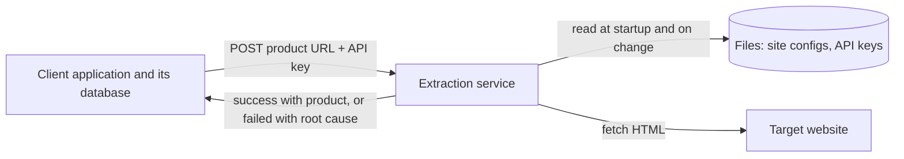
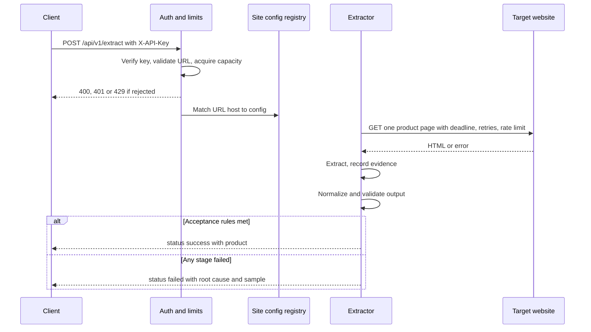
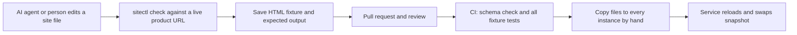

# Proposal: Stateless Synchronous Product Extraction Service

## 1. Summary

Replace the current whole-site crawler design with a single, stateless HTTP endpoint. That design is only partly built today: no crawl runs automatically, category discovery runs only from tests, and product scraping is never called.

The clients are other applications that call this service over HTTP. There are no human users and no admin API.

A client application sends the URL of one product page with an API key. This service verifies the key, finds the parsing configuration for that website in a local file, fetches that single page, extracts the product from its HTML, and returns one of two results in the same HTTP response:

- **`success`**: the extracted product.
- **`failed`**: the root cause, a detailed explanation, and a sample of the problem.

Each request handles exactly one product page. The service does not discover products, read category or listing pages, or follow pagination. The client already knows which product URLs it wants and sends one request per product.

The service has no database and no Redis. The client owns all persistence, including storing each request and response. Configuration for more than 100 websites lives in JSON files. API keys are generated in bulk by a command and stored as keyed hashes, in a `.env` file in production. Site configs and key files are usually produced by an AI agent and copied by hand to every instance.



## 2. What changes

| Area | Today | Proposed |
|---|---|---|
| Trigger | Crawl of whole sites, intended to run on a schedule | One client request for one product page |
| Scope of one run | Many categories, listing pages, and product pages | One product page |
| Product discovery | Crawler walks categories and pagination | Not done by the service. The client supplies product URLs |
| Execution | Background poller and workers | Synchronous inside the HTTP request |
| Storage | PostgreSQL and Redis | None |
| Scraper configs | `configs` table, 2 sites seeded | One JSON file per site, 100+ sites |
| Authentication | JWT for admin routes | API key per client application, stored only as a keyed hash in a file (`.env` format in production) |
| API surface | CRUD for 4 resources, Swagger | REST only: `POST /api/v1/extract`, `/health`, `/ready`, and Swagger UI, `/openapi.yaml`, and `/metrics` behind operator credentials. No admin API |
| Failure reporting | Log lines | Structured root cause and evidence in the response |
| Request history | Stored in database | Stored by the client |

The table above covers only what changes. [Section 11](#11-current-system-what-stays-what-changes-what-goes) describes the parts of the current system that stay.

## 3. Goals and non-goals

### Goals

- Extract one product from a given product page URL, using per-site configuration.
- Support 100+ sites without code changes for each new site.
- Make every failure diagnosable from the response alone.
- Keep the service stateless so any instance can handle any request.
- Process exactly one product page per request and respond within 3 minutes.
- Provide commands to generate API keys one at a time or in bulk, and to list and revoke them.

### Non-goals for the first version

- Reading category or listing pages, following pagination, or discovering product URLs.
- An admin API or admin UI for keys or configurations.
- Rendering JavaScript with a headless browser. JS-only pages are detected and reported as a specific failure.
- Solving CAPTCHAs or bypassing anti-bot systems.
- Scheduling, job queues, or resuming interrupted work.
- Storing results or request history.

## 4. Architecture

### Request flow



### Pipeline stages

Each stage after `request` can report a failure, and that stage name appears in the response.

| Stage | Responsibility |
|---|---|
| `request` | Validate the body and URL. Problems here return HTTP 400, not a `failed` result |
| `config` | Find the site config and check the URL is a product page |
| `fetch` | Retrieve HTML: DNS, TLS, HTTP status, redirects, size, encoding |
| `page_check` | Detect block pages, CAPTCHA, JS-only pages, and empty pages |
| `extract` | Run the product page selectors |
| `normalize` | Clean the title, parse prices, decide availability, resolve URLs |
| `validate` | Apply acceptance rules to the final result |

### State

All working state lives in the memory of a single request. At startup each instance loads immutable snapshots of the site configs and API keys. The only shared in-memory state is the concurrency limiter.

## 5. API contract

### Request

```http
POST /api/v1/extract
X-API-Key: gwp_k7f3a9c2_<secret>
Content-Type: application/json
```

```json
{
  "url": "https://badomjip.com/product/example/",
  "request_id": "client-generated-id-123"
}
```

| Field | Required | Notes |
|---|---|---|
| `url` | Yes | One product page. `http` or `https`, on a domain with a site config |
| `request_id` | No | Echoed in the response and logs. Generated if missing |

The response describes one product, including its description. The site config's `match` patterns decide whether the URL is a product page. A URL that matches no pattern, such as a category page, returns `failed` with `NOT_PRODUCT_URL`.

### Success response

```json
{
  "status": "success",
  "request_id": "client-generated-id-123",
  "url": "https://badomjip.com/product/example/",
  "site_id": "badomjip",
  "config_version": "2026-11-08.1",
  "started_at": "2026-11-08T10:00:00Z",
  "finished_at": "2026-11-08T10:00:03Z",
  "duration_ms": 3120,
  "product": {
    "title": "Example product",
    "url": "https://badomjip.com/product/example/",
    "image_url": "https://badomjip.com/wp-content/uploads/example.jpg",
    "description": "First paragraph.\nSecond paragraph.",
    "price": {
      "current": 400000,
      "regular": 500000,
      "currency": "IRT",
      "raw": "500,000 تومان 400,000 تومان",
      "state": "available"
    }
  },
  "warnings": [
    {
      "code": "FIELD_MISSING",
      "field": "image_url",
      "message": "The image_url field was not found on this product page."
    }
  ]
}
```

`product.url` is the page's `<link rel="canonical">` when it points to one of the site's domains, and otherwise the final URL after redirects.

### Price and availability

`price.state` is one of these values, decided in this order. The first match wins:

| State | When |
|---|---|
| `call_for_price` | The price area contains one of the site's `call_for_price_words` |
| `out_of_stock` | The product cannot be ordered: the `availability.out_of_stock` selector matches, or the `availability.order_button` selector is configured and finds no button |
| `available` | A current price was parsed and the product can be ordered |
| `unknown` | No price and no other signal |

`call_for_price` is checked first because those products usually have no order button either.

A missing price is `null`, never `0`. A product with no price still counts as complete; it gets a `PRICE_MISSING` warning only when the state is `unknown`. An `out_of_stock` product keeps any price the page still shows.

**Currency.** Prices are always returned in toman, and `currency` is always `IRT`. A site that shows prices in rial sets `locale.price_unit` to `rial`, and its prices are divided by 10. `raw` keeps the text exactly as the page showed it.

**Price ranges and variants.** A product with variants, such as sizes or weights, often shows a range like `100,000 – 200,000 تومان`. The service returns the lowest price as `current`. If the page also shows a crossed-out regular range, `regular` is the lowest value of that range. `raw` keeps the full range text.

### Failed response

```json
{
  "status": "failed",
  "request_id": "client-generated-id-123",
  "url": "https://badomjip.com/product/example/",
  "site_id": "badomjip",
  "config_version": "2026-11-08.1",
  "duration_ms": 2140,
  "error": {
    "code": "SELECTOR_NOT_FOUND",
    "stage": "extract",
    "owner": "site_config",
    "retryable": false,
    "confidence": "high",
    "message": "The product block was not found on the page.",
    "root_cause": "The page returned HTTP 200 with real content, but selector 'div.product.type-product' matched 0 elements. The site markup has probably changed.",
    "suggested_action": "Update pages.product.root in configs/sites/badomjip.com.json."
  },
  "evidence": {
    "failed_url": "https://badomjip.com/product/example/",
    "final_url": "https://badomjip.com/product/example/",
    "redirects": [],
    "http_status": 200,
    "attempts": 1,
    "content_type": "text/html; charset=UTF-8",
    "body_bytes": 184233,
    "body_sha256": "9f2c0d...",
    "page_title": "Example product - Badomjip",
    "selector_trace": [
      { "selector": "div.main-page-wrapper", "matches": 1 },
      { "selector": "div.main-page-wrapper div.site-content", "matches": 1 },
      { "selector": "div.product.type-product", "matches": 0 }
    ],
    "html_sample": {
      "reason": "Deepest element matched by the failing selector path",
      "content": "<div class=\"site-content\"><article class=\"new-product\">...</article></div>",
      "truncated": true,
      "original_length": 48211
    }
  },
  "partial": {
    "product": null
  }
}
```

### HTTP status rules

The HTTP status says whether the service processed the request. The `status` field says what happened.

| HTTP | Meaning |
|---|---|
| 200 | Processing ran. Read `status` for `success` or `failed` |
| 400 | Body is not valid JSON, `url` is missing, or `url` is malformed or not `http`/`https` (`INVALID_URL`) |
| 401 | API key missing, unknown, revoked, or expired. The same response for all four |
| 429 | No capacity right now; `Retry-After` is included |
| 503 | Instance is shutting down |

Both extraction outcomes use 200 so that a failure on the target website, such as its own 404, cannot be confused with an error from this API. Clients must check `status`, never only the HTTP code.

Responses with status 400, 401, 429, and 503 have the body `{"code": "...", "message": "..."}`. The 400 codes are `INVALID_REQUEST` and `INVALID_URL`. [Section 17](#17-swagger-and-client-generation) has the full OpenAPI contract, with samples of every response.

### Result rules

| Situation | Result |
|---|---|
| All required fields found, and the price parsed or the state is `call_for_price` or `out_of_stock` | `success` |
| Same, but an optional field such as `image_url` or `description` is missing, or the price state is `unknown` | `success` with warnings |
| A required field is missing | `failed` with `REQUIRED_FIELD_MISSING`; what was found is returned in `partial.product` |
| Price text was found but could not be parsed | `failed` with `PRICE_PARSE_FAILED`; what was found is returned in `partial.product` |
| The page cannot be fetched after retries | `failed` |
| Deadline reached | `failed` with `DEADLINE_EXCEEDED` |

A `failed` result describes that one request. The client must not treat a product as removed from the site because of a `failed` result. Only `HTTP_NOT_FOUND`, meaning HTTP 404 or 410, means the product is gone.

The service does not try to detect deleted products in any other way. A site that shows a "not found" page with HTTP 200 gives `SELECTOR_NOT_FOUND`. A site that redirects a deleted product to a category or the home page gives `NOT_PRODUCT_URL` or `REDIRECT_NOT_ALLOWED`. Neither of these means the product is gone.

## 6. Root-cause diagnosis

Diagnosis is rule-based and deterministic, so the same input gets the same answer. `confidence` is `high` when the evidence is direct, such as a DNS error, and `medium` for heuristics, such as JS-only detection.

### Failure codes

These codes appear in `failed` results with HTTP 200. `INVALID_URL` is not in this table because it returns HTTP 400.

| Code | Stage | Owner | Retryable | Root cause |
|---|---|---|---|---|
| `SITE_NOT_CONFIGURED` | config | site_config | No | No config for this host |
| `SITE_DISABLED` | config | site_config | No | Config has `enabled: false` |
| `CONFIG_INVALID` | config | site_config | No | Config failed schema validation |
| `NOT_PRODUCT_URL` | config | client | No | URL matches none of the site's product page patterns |
| `URL_NOT_ALLOWED` | fetch | client | No | Host resolved to a private address, or a blocked port |
| `DNS_FAILED` | fetch | source_site | Yes | Host name did not resolve |
| `CONNECTION_FAILED` | fetch | source_site | Yes | Connection refused or reset |
| `TLS_FAILED` | fetch | source_site | No | Invalid certificate or handshake failure |
| `FETCH_TIMEOUT` | fetch | source_site | Yes | Site did not respond in time |
| `HTTP_NOT_FOUND` | fetch | client | No | HTTP 404 or 410 |
| `ACCESS_DENIED` | fetch | source_site | No | HTTP 401 or 403 without anti-bot signs |
| `RATE_LIMITED` | fetch | source_site | Yes | HTTP 429 after retries |
| `SOURCE_SERVER_ERROR` | fetch | source_site | Yes | HTTP 5xx after retries |
| `REDIRECT_NOT_ALLOWED` | fetch | site_config | No | Redirect left the site's configured domains |
| `TOO_MANY_REDIRECTS` | fetch | source_site | No | Redirect loop |
| `UNSUPPORTED_CONTENT` | fetch | source_site | No | Response is not HTML |
| `RESPONSE_TOO_LARGE` | fetch | service | No | Body exceeded the size limit |
| `BOT_PROTECTION` | page_check | source_site | No | Anti-bot challenge or CAPTCHA page |
| `JS_RENDERED_PAGE` | page_check | site_config | No | HTML is an application shell without product markup |
| `EMPTY_PAGE` | page_check | source_site | Yes | Body is empty or has almost no text |
| `SELECTOR_NOT_FOUND` | extract | site_config | No | The product `root` selector matched nothing |
| `REQUIRED_FIELD_MISSING` | validate | site_config | No | A field in `required_fields` was not found |
| `PRICE_PARSE_FAILED` | normalize | site_config | No | Price text was found but could not be parsed |
| `DEADLINE_EXCEEDED` | any | service | Yes | Overall time limit reached |
| `INTERNAL_ERROR` | any | service | Yes | Recovered panic or an unexpected bug |

### How causes are separated

**HTTP 401 and 403.** The body of a 401 or 403 response still goes through `page_check`. If it shows anti-bot signs, the result is `BOT_PROTECTION`; otherwise it is `ACCESS_DENIED`. Neither code is retried, so `attempts` is 1 for both.

**HTTP 200 without a product.** This is the hardest case, because it has several possible causes. Checks run in this order and the first match wins:

1. **Block page:** challenge headers such as `cf-mitigated`, or known CAPTCHA and challenge markup gives `BOT_PROTECTION`.
2. **Empty document:** almost no visible text gives `EMPTY_PAGE`.
3. **JS shell:** an app root element, large script payloads, and little text gives `JS_RENDERED_PAGE`.
4. **Layout change:** the page has content but the `root` selector failed, giving `SELECTOR_NOT_FOUND`.

### Evidence sample

| Item | Purpose |
|---|---|
| Failed URL, final URL, redirect chain | Shows what was actually loaded |
| HTTP status and attempts | Separates transient problems from permanent ones |
| Allow-listed response headers | `server`, `content-type`, `retry-after`, `cf-ray`, and `cf-mitigated`. `Set-Cookie` is never returned |
| Body size, SHA-256, page title | Identifies the page without returning all of it |
| `selector_trace` | Match count for each step of the failing selector path, showing where it broke |
| `html_sample` | Up to 16 KiB chosen for the failure type |
| `field_samples` | Raw text found for each field, for field and price errors |

`html_sample` shows the start of the body for block and empty pages, and the deepest matched element for selector failures.

The sample is untrusted third-party HTML. It is always a JSON string, and the client must escape it if it is ever displayed.

## 7. Site configuration

### Files

```text
configs/
  schema/site-config.v1.json     JSON Schema used by tools and startup
  templates/
    woocommerce.json             Shared selectors for WooCommerce
    woodmart.json                Theme overrides; extends woocommerce
    prestashop.json
  sites/
    badomjip.com.json
    hosseinibrothers.ir.json
    ...
```

One file per site keeps reviews and ownership simple. Templates matter at this scale because many shops share a platform or theme. A template change does affect every site that uses it, so fixture tests ([§14](#14-testing)) must run for all of them.

### Example site config

```json
{
  "schema_version": 1,
  "site_id": "badomjip",
  "version": "2026-11-08.1",
  "enabled": true,
  "extends": "woodmart",
  "domains": ["badomjip.com", "www.badomjip.com"],

  "fetch": {
    "user_agent": "ProductExtractor/1.0",
    "delay_ms": 1000,
    "timeout_seconds": 30,
    "retries": 2,
    "respect_robots_txt": true
  },

  "locale": {
    "price_unit": "toman",
    "currency_words": ["تومان"],
    "call_for_price_words": ["تماس بگیرید"]
  },

  "pages": {
    "product": {
      "match": ["^/product/"],
      "root": "div.product.type-product",
      "fields": {
        "title": { "selector": "h1.product_title", "pick": "first" },
        "image_url": { "selector": "div.woocommerce-product-gallery img", "attr": ["data-src", "src"], "pick": "first" },
        "price_current": { "selector": "p.price ins .amount, p.price > .amount", "pick": "first" },
        "price_regular": { "selector": "p.price del .amount", "pick": "first" },
        "description": {
          "selector": "div.woocommerce-product-details__short-description p, div.woocommerce-Tabs-panel--description p",
          "pick": "join",
          "separator": "\n"
        }
      },
      "availability": {
        "out_of_stock": "p.stock.out-of-stock",
        "order_button": "button.single_add_to_cart_button"
      }
    }
  },

  "validation": {
    "required_fields": ["title"]
  }
}
```

| Rule | Behavior |
|---|---|
| `extends` | Objects are merged deeply; a site's arrays replace the template's arrays |
| `root` | The element that contains the product. If it matches nothing, the result is `SELECTOR_NOT_FOUND`. Field selectors run inside it |
| `pick` | `first`, `last`, or `join`. This fixes the current bugs where sale prices merge and only the last description paragraph survives |
| `attr` | Tried in order, which supports lazy-loaded images |
| `availability` | Decides `out_of_stock`, meaning the product cannot be ordered. Both selectors are optional |
| `price_unit` | `toman` (default) or `rial`. Rial prices are divided by 10, because the service always returns toman |
| `required_fields` | Fields that must be found. The price is not required, because a product without a price still counts as complete |
| `domains` | All accepted hostnames, solving the current `www.` mismatch |
| `delay_ms` | Minimum gap between this instance's requests to the site |
| `match` | Go regular expressions on the URL path; Go's engine runs in linear time |

Configuration contains selectors and data only. There are no scripts or custom code in config files.

### No SQL schema

The new service has no SQL schema. There is no `configs` table, no migrations, and no seed files, and site configs are never loaded from a database. The JSON files under `configs/` are the only source.

Nothing is migrated from the current SQL seeds. Every site file, including the two that are seeded today, is written new against product pages. `internal/storage/sql/seeds/002_seed_configs.sql` can be read once for reference and is then deleted. Its description selectors target product pages, but its title, price, and image selectors target listing cards, so they do not carry over.

### Lifecycle

Site configs are usually written by an AI agent. The agent uses the same steps a person would, and the pull request review and CI checks apply to its work in the same way.



- **Startup:** every file is validated. An invalid site is marked unavailable and returns `CONFIG_INVALID`, so one bad file cannot take down the other sites. CI blocks invalid files before this point.
- **Reload:** the service polls file timestamps every 30 seconds and swaps in a complete new snapshot. If the new set cannot be loaded, the previous one stays active.
- **In-flight requests** keep the snapshot they started with.
- **`config_version`** is returned with every result, so a stored response can be traced to the exact rules used.
- **Copies can drift.** Files are copied to each instance by hand. `sitectl coverage` prints each site's `version`, and each instance logs the versions it loaded, so a missed copy can be found by comparing them.

### `sitectl` tool

| Command | Purpose |
|---|---|
| `sitectl validate` | Check schema and references for all files |
| `sitectl check --url <url>` | Run a real extraction on one product page and print the product and diagnostics |
| `sitectl fixture --url <url>` | Save HTML and expected output for testing |
| `sitectl test` | Run all fixtures offline |
| `sitectl coverage` | List sites and their status, version, and template |

The output of these commands is designed to be read by an AI agent as well as a person: each command also supports `--json`.

## 8. API keys

Each client application gets its own key, so one application can be revoked without affecting the others.

### Storage decision: keyed hash rather than reversible encryption

The service only needs to check whether a key is correct, so it never needs the original value.

| Option | Reveals keys if the file leaks? | Reveals keys if the file and secret both leak? | Verification cost | Verdict |
|---|---|---|---|---|
| AES-256-GCM encryption | No | **Yes, all keys** | Low | Only needed if plaintext must be recovered |
| **HMAC-SHA-256 with a server secret** | No | No, keys remain infeasible to brute-force at 256 bits | Very low | **Recommended** |
| Argon2 or bcrypt | No | No | High on every request | Built for low-entropy passwords; unnecessary here |

This meets the intent of storing keys protected in a file and is stronger than encryption for this use. If the requirement is literally reversible encryption, AES-256-GCM can replace it without changing the API.

### Key format

```text
gwp_k7f3a9c2_Xk3vN0p...43-character-random-secret
│   │        └─ 256 bits from crypto/rand, base64url
│   └─ public key ID, used to look up the entry
└─ prefix, makes leaked keys easy to detect by secret scanners
```

### Key files

| Environment | Default file | Format |
|---|---|---|
| Production | `secrets/.env.apikeys` | `.env` |
| Development and test | `secrets/api_keys.json` | JSON |

Files ending in `.json` are read as JSON, and anything else as `.env`. Both formats produce the same in-memory entries and hold hashes only. Both files have permission `0600`, and `secrets/` must be added to `.gitignore`.

#### Production `.env` file

Each key is one line, in the form `APIKEY_<ID>=algorithm,status,created_at,expires_at,name,hash`:

```dotenv
# Managed by the apikey command. Contains hashes only.
APIKEY_K7F3A9C2=hmac-sha256,active,2026-11-08T10:00:00Z,2027-11-08T10:00:00Z,catalog-service,m3Vt6s2n7Q0E9hH8bX1pYwK5rN4dJ2uF0cA6zL8gT1c
APIKEY_P2M8X4Q1=hmac-sha256,active,2026-11-08T10:00:00Z,never,pricing-service,Zq8LwT3vB6nR1yKf9XcH2sJd5uPa7Ge4mVoI0tNbQ_w
```

Hashes are unpadded base64url, and key names may only contain letters, digits, `-`, and `_`, so values never need quoting.

- **The service reads this file directly.** It does not go through `LoadEnv`, which stops at the first `.env` file it finds and would skip this one.
- **Mount the file instead of using `docker run --env-file`.** Environment variables are fixed when a process starts, so a revoked key would stay valid until a restart.
- **Changes apply without a restart.** Each instance checks the file every 30 seconds and swaps in a complete new snapshot.
- **A bad file is rejected as a whole.** At startup the service refuses to start. During a reload it keeps the previous snapshot and logs an error.
- **The pepper is kept separate.** `APP_API_KEY_PEPPER` must never be placed in this file.

#### Development JSON file

```json
{
  "version": 1,
  "keys": [
    {
      "id": "k7f3a9c2",
      "name": "catalog-service",
      "algorithm": "hmac-sha256",
      "hash": "m3Vt6s2n7Q0E9hH8bX1pYwK5rN4dJ2uF0cA6zL8gT1c",
      "status": "active",
      "created_at": "2026-11-08T10:00:00Z",
      "expires_at": "2027-11-08T10:00:00Z"
    }
  ]
}
```

The HMAC secret comes from `APP_API_KEY_PEPPER`, supplied by the environment or a secret manager. It is never stored in a key file or the repository.

### `apikey` commands

All commands use the file in `APP_API_KEYS_FILE` unless `--output` is given.

```bash
# Create the server secret once, before the first key
apikey generate-pepper

# One key, stored in a .env file
apikey generate --name catalog-service --expires-in 8760h --output secrets/.env.apikeys

# Many keys: names become app-001, app-002, ...
apikey generate-bulk \
  --count 100 \
  --name-prefix app \
  --expires-in 8760h \
  --plain-output /secure/app-keys.csv

# Many keys with chosen names, one name per line
apikey generate-bulk \
  --names-file clients.txt \
  --expires-in 8760h \
  --plain-output /secure/client-keys.csv

apikey list
apikey revoke --id k7f3a9c2
apikey revoke --name-prefix app
```

- `generate` shows the full key **once**. It cannot be recovered afterwards.
- `list` shows metadata only, never hashes.
- Rotation means generating a second key, moving the client over, then revoking the old one.
- Writes hold a file lock and use temp-file, `fsync`, and rename, so a crash cannot corrupt the file.

### Bulk generation

`generate-bulk` writes two files:

| File | Contents | Purpose |
|---|---|---|
| Key file (`APP_API_KEYS_FILE`) | Hashes only | Read by the service |
| `--plain-output` CSV | `id,name,key,expires_at`, including the full keys | One-time handover to client applications |

Rules for a bulk run:

1. **All or nothing.** The CSV is written first. If updating the key file then fails, the CSV is deleted and no keys are created.
2. **Existing keys are kept.** New entries are added to the file, and a run stops if a generated ID or a name already exists.
3. **The CSV is protected.** It has permission `0600`, and the command refuses to overwrite an existing file.
4. **Plaintext stays out of key files.** Deliver the CSV through a secure channel, then delete it. It is the only copy of those keys.

Key lookup is by ID in memory, so verification takes the same time with 10 keys or 10,000.

### Using an AI agent to generate keys

Key files are usually produced by an AI agent running the `apikey` commands. The commands are built so that the agent never needs to see a secret:

- The pepper is read from the environment. The agent must not be given it in its prompt, and must not print it.
- Full keys go only to the `--plain-output` file. The commands never print full keys to standard output when `--plain-output` is given, so they do not appear in the agent's transcript or logs.
- The agent may read the hash-only key file and the output of `apikey list`. It must not open the CSV.

### Setting keys on the production server

Keys are generated from the command line into a `.env` file on an operator's machine, then copied by hand to every production instance. The service has no endpoint for creating keys, and the commands do not connect to production.

1. **Create the pepper, once.** Run `apikey generate-pepper`, which prints a new random value. Set it as `APP_API_KEY_PEPPER` on every production instance.
2. **Generate the keys.** Use the same pepper on the operator's machine. The commands stop with an error if it is not set.

   ```bash
   export APP_API_KEY_PEPPER='<production pepper>'
   apikey generate-bulk \
     --count 100 \
     --name-prefix app \
     --expires-in 8760h \
     --output secrets/.env.apikeys \
     --plain-output /secure/app-keys.csv
   ```

3. **Copy them to every instance.** Copy `secrets/.env.apikeys` to the path in `APP_API_KEYS_FILE`, or paste the new `APIKEY_...` lines into the existing file, and set permission `0600`. Repeat on every instance.
4. **Confirm the reload.** Within 30 seconds each instance logs how many keys it loaded and a checksum of the file. Compare the checksums to confirm every instance has the same file. If the file has a mistake, the instance logs an error and keeps the previous keys.
5. **Deliver the keys.** Send the CSV to each client application's owner through a secure channel, then delete it.

Keys hashed with a different pepper fail verification, so the pepper must match on the operator's machine and every instance. Changing the pepper invalidates every existing key.

To revoke a key manually, change its status from `active` to `revoked`, or delete its line, on every instance. If the file on the operator's machine is the master copy, make the same change there with `apikey revoke`, otherwise the next full copy brings the key back.

### Verification

1. Read `X-API-Key` and parse the key ID.
2. Look up the entry in the in-memory snapshot.
3. Compute the HMAC and compare it with `hmac.Equal`, which runs in constant time.
4. Check `status` and `expires_at`.
5. On any failure, return the same 401 response.

The same comparison runs against a fixed dummy hash for unknown IDs, so response timing doesn't reveal which IDs exist. Keys are never logged. Only the key ID is recorded. TLS is required because the key travels in a header.

## 9. Request duration and capacity

### Where the time goes

A typical request takes a few seconds: one page fetch plus parsing. This is the worst case:

```text
wait for the site's turn     30s
robots.txt fetch             30s
3 attempts × 30s timeout     90s
backoff between attempts      3s
                           ≈ 2.5 minutes
```

The `robots.txt` fetch shares the request's deadline and the site's `delay_ms`. The service enforces a hard limit of 3 minutes per request.

The total time a client needs depends on how many products it requests. With 1 second latency and a 1 second delay per site, 1000 products from one site take about 1000 × 2s ≈ 35 minutes. Products from different sites run in parallel, up to the per-instance limit.

That long run is made of many short requests. A failure loses one product, and the client can resume from its own database.

### Connection

Client applications connect directly to the Go service. There is no Nginx or other reverse proxy, so the service handles HTTPS and its own connection limits.

| Component | Required setting |
|---|---|
| Go `http.Server` | `ReadHeaderTimeout` 10s, `MaxHeaderBytes` 64 KiB, `WriteTimeout` 190s |
| Request body | Limited to 1 MiB with `http.MaxBytesReader` |
| Existing 60-second Gin timeout middleware | Removed, because the 3-minute deadline replaces it |
| Client HTTP library | Timeout of 190 seconds, just above the service's limit |

### HTTPS

The Go server terminates TLS itself. When `APP_TLS_CERT_FILE` and `APP_TLS_KEY_FILE` are set, it serves HTTPS on `APP_HTTP_PORT`.

Without them it serves plain HTTP and logs a warning in production. Plain HTTP is only acceptable on a private network, because the API key is sent in a header.

### Limits and cancellation

| Limit | Default | When reached |
|---|---|---|
| Duration per request | 3 minutes | `DEADLINE_EXCEEDED` |
| Concurrent requests per instance | 20 | HTTP 429 |
| Concurrent requests per site | 1 | Waits up to 30 seconds for its turn, then HTTP 429 |
| HTML per page | 10 MB | `RESPONSE_TOO_LARGE` |
| HTML sample in a failure | 16 KiB | Truncated and flagged |

- A new Colly collector is created for each request, so URL history cannot leak between requests. When `respect_robots_txt` is on, this means one extra small fetch of `robots.txt` per request.
- The request's context is passed to the collector with `colly.StdlibContext`, so client disconnects and deadlines cancel outgoing fetches. If the client disconnects, the work is discarded.
- Retries use backoff and respect `Retry-After`, within the overall deadline.

The per-site limit and `delay_ms` protect target websites while clients request many products. They are per instance, so with `N` instances a site can receive up to `N` concurrent requests.

### Deployment

An instance drains before it stops:

1. `/ready` and new extraction requests start returning 503.
2. Running requests finish, up to `APP_MAX_REQUEST_DURATION`.
3. The process manager's stop timeout must be longer than that limit (for example, systemd `TimeoutStopSec=190`, or Kubernetes `terminationGracePeriodSeconds` set to 190).

With no load balancer in front, clients call a known address. A single instance accepts no new work while it drains, which lasts at most about 3 minutes. With several instances, the client must choose one and try another after a 429 or 503.

Client retries are safe because extraction only reads from target sites, and a retry repeats only one product.

## 10. Security

| Risk | Control |
|---|---|
| **SSRF**: using the service to reach internal systems | Only hosts in site configs are accepted. Redirects are limited to the same site's `domains`. A custom dialer rejects private, loopback, link-local, and metadata addresses after DNS resolution |
| Malicious HTML | Parsed only, never executed. Size limited. Samples are returned as strings |
| Key leakage | Hashed storage, recognizable prefix, no logging, expiry, revocation, TLS, and AI agents never see the pepper or full keys |
| Resource exhaustion | Concurrency, size, and duration limits |
| Exposed operational endpoints | Swagger UI, `/openapi.yaml`, and `/metrics` require operator credentials. See [Protected endpoints](#protected-endpoints) |
| Regular expression abuse | Go's linear-time engine, and patterns come from reviewed files only |
| Sensitive data in responses | Header allow-list; no cookies returned |
| Over-collection from target sites | Per-site rate limits, identifiable User-Agent, `robots.txt` on by default |

There are no per-key quotas or rate limits. Client applications are trusted, and the per-instance and per-site limits are enough.

### Protected endpoints

| Endpoint | Access |
|---|---|
| `POST /api/v1/extract` | API key in `X-API-Key` |
| `/health`, `/ready` | Public, so process managers and probes can call them |
| `/swagger/*`, `/openapi.yaml`, `/metrics` | Operator credentials with HTTP Basic authentication |

Basic authentication is used because a browser can send it when opening Swagger UI, and Prometheus supports it for scraping. Client API keys are not accepted on these endpoints.

- The username is `APP_OPS_USER`. The password is stored only as a keyed hash in `APP_OPS_PASSWORD_HASH`, using the same HMAC and pepper as API keys. `apikey hash-ops-password` reads a password from standard input and prints its hash.
- The check uses `hmac.Equal`, and every failure returns the same 401 with a `WWW-Authenticate` header.
- If either variable is not set, these endpoints return 404, so they are off unless an operator turns them on.
- Basic authentication sends the password with every request, so these endpoints need HTTPS like the API.

## 11. Current system: what stays, what changes, what goes

The application framework stays and the parsing approach carries over. The data side, the admin API, and product discovery go away. No crawler code stays exactly as it is, but its core design does.

### Unchanged

| Part | How it works | Location |
|---|---|---|
| Startup | `main` calls `config.LoadEnv()`, then `app.NewApp().Run()` | [`cmd/server/main.go`](../cmd/server/main.go) |
| Uber Fx wiring | All components are listed in one file, and Fx builds them and handles start and stop. Only the list gets shorter | [`internal/app/app.go`](../internal/app/app.go) |
| Environment loading | Reads the first file found (`.env.<env>`, then `.env`), and variables use the `APP_` prefix | [`internal/config/config.go`](../internal/config/config.go) |
| Config validation style | Each setting has a check, and the app does not start if one fails | [`internal/config/validate.go`](../internal/config/validate.go) |
| Logging | Zap writes JSON to stdout and flushes on stop | [`pkg/logger/logger.go`](../pkg/logger/logger.go) |
| Health check | `GET /health` returns `{"message":"OK"}` | [`internal/health/health.go`](../internal/health/health.go) |
| Gin basics | Request logging, panic recovery, and the JSON 404 | [`internal/server/`](../internal/server/) |
| Colly | Still the library that fetches and parses pages | [`internal/crawler/`](../internal/crawler/) |
| Tooling | `go test`, coverage commands, and SonarQube | [`README.md`](../README.md) |

### Same idea, modified code

| Part | What stays | What changes |
|---|---|---|
| Selector-based parsing | Each site defines CSS selectors for the data it needs | Selectors move from the `configs` table to JSON files, with new options such as `root`, `pick`, and `availability`. Only product page selectors remain |
| Extraction steps | Scrape the page, then clean the data | One request handles one product page, with cancellation and failure details added. `crawler/product` and `crawler/description` become one stateless extractor for product pages |
| Polite fetching | A delay between requests to a site | The delay becomes a per-site setting applied across requests. Parallel fetching within a request is removed |
| Data cleaning (`crawler/domain/cleanup.go`) | Removes HTML from titles, removes `تومان` and commas, and converts Persian digits | Adds Arabic digits, separate sale and regular prices, the lowest price of a range, rial to toman conversion, and availability. A missing price becomes `null`, not `0` |
| Domain types (`crawler/domain/domain.go`) | Website, product, and selector concepts | Evolve into the new config and result types |
| Site data (`seeds/002_seed_configs.sql`) | The same two sites are supported | Rewritten from scratch as JSON files for product pages. The SQL seed file is only a reference and is deleted with the rest of the SQL schema, as described in [section 7](#no-sql-schema) |
| HTTP server (`internal/server`) | Same Gin engine and graceful stop | The 60-second timeout is removed, and the 5-second shutdown limit grows so long requests can finish |
| Config struct (`internal/config`) | Same loading and validation | Database, Redis, and JWT settings are removed, and new settings are added |
| `Dockerfile` | Same overall approach | The broken build path is fixed and `configs/` is copied in |
| Swagger | Same `gin-swagger` UI at `/swagger/index.html` | The generated `docs/` folder and `swag` annotations are replaced by a hand-written OpenAPI 3.0 file, as explained in [section 17](#17-swagger-and-client-generation) |
| `docker-compose.yaml` | SonarQube service | Postgres and Redis services are removed |

### Removed or replaced

| Current code | Plan |
|---|---|
| `internal/storage/*`, `sqlc.yaml`, migrations, seeds | **Remove**; the service has no database, no SQL schema, and no Redis |
| `internal/{website,category,product,configs}` | **Remove** the admin APIs. Nothing else depends on them |
| `crawler/category`, `crawler/website` | **Remove**; the client now supplies product URLs |
| Listing selectors and pagination | **Remove**; the service never reads listing pages |
| `internal/poller/*`, `internal/example` | **Remove** the poller, dispatcher, and workers |
| `internal/auth`, JWT middleware | **Replace** with API key authentication |

### Proposed layout

```text
api/
  openapi.yaml    API contract with request and response samples
  embed.go        Embeds the contract into the binary
cmd/
  server/         HTTP service
  apikey/         Key generation (single and bulk), listing, and revocation
  sitectl/        Config validation and testing tool
configs/          Site configs, templates, schema
secrets/          API key files, not in git and not baked into images
internal/
  app/            Fx wiring
  server/         Gin and timeouts
  apikey/         Key generation, hashing, file storage, snapshot
  siteconfig/     Loader, template merge, validation, registry
  extract/        Pipeline orchestration
  fetch/          Colly setup, safe dialer, retries, evidence capture
  normalize/      Title, price, availability, URL cleanup
  diagnose/       Page checks, failure codes, selector trace, samples
  limiter/        Per-instance and per-site concurrency
testdata/sites/   HTML fixtures and expected output
```

## 12. Environment variables

| Variable | Default | Purpose |
|---|---|---|
| `APP_ENV` | none | `development`, `test`, or `production` |
| `APP_HTTP_PORT` | `4000` | Listen port |
| `APP_SITE_CONFIG_DIR` | `configs` | Config root |
| `APP_API_KEYS_FILE` | `secrets/.env.apikeys` in production, otherwise `secrets/api_keys.json` | Key file |
| `APP_API_KEY_PEPPER` | none, required | HMAC secret |
| `APP_OPS_USER` | none | Username for Swagger UI, `/openapi.yaml`, and `/metrics`. Those endpoints are off when unset |
| `APP_OPS_PASSWORD_HASH` | none | Keyed hash of the operator password, from `apikey hash-ops-password` |
| `APP_TLS_CERT_FILE` | none | TLS certificate; enables HTTPS together with the key file |
| `APP_TLS_KEY_FILE` | none | TLS private key |
| `APP_MAX_REQUEST_DURATION` | `3m` | Hard limit per request |
| `APP_SITE_WAIT_TIMEOUT` | `30s` | How long a request waits for its turn on a busy site |
| `APP_MAX_CONCURRENT_REQUESTS` | `20` | Per-instance capacity |
| `APP_MAX_CONCURRENT_PER_SITE` | `1` | Per-site capacity |

## 13. Observability

The service stores no history, so the client's stored responses are the record of individual requests. The service provides aggregate visibility through logs and metrics.

- **Logs:** JSON with `request_id`, `site_id`, `config_version`, `key_id`, outcome, code, and duration.
- **Startup and reload logs:** the number of keys and sites loaded, each site's `version`, and a checksum of the key file. Because files are copied by hand, these are how you confirm that every instance has the same files.
- **Metrics** on `/metrics`, behind operator credentials:
  - Requests by outcome, site, failure code, and price state.
  - Duration, active requests, and 429 count.
- **Most useful alert:** a jump in `SELECTOR_NOT_FOUND` or `REQUIRED_FIELD_MISSING` for a site, which usually means its layout changed.

## 14. Testing

| Level | Scope | Network |
|---|---|---|
| Unit | Key hashing, config merge, price parsing (including ranges and rial to toman), availability rules, each failure classifier | None |
| Fixture | Every site's saved HTML against expected output, run through `sitectl test` | None |
| Integration | Full endpoint against a local `httptest` server: 400, 403, 429, 500, redirects, timeouts, disconnects, oversized pages | Local only |
| Contract | `openapi.yaml` is valid, its samples match its schemas, and real endpoint responses match the spec | Local only |
| Live smoke | Optional scheduled `sitectl check` for each site, outside CI | Internet |

Each site needs at least one product page fixture before it can be merged. Where the site has them, add fixtures for an out-of-stock product and a call-for-price product too.

## 15. Delivery plan

| Phase | Deliverable | Done when |
|---|---|---|
| 1. Skeleton | Remove DB, Redis, poller, admin API, and discovery code; add `/health` and `/ready` | App starts with no dependencies |
| 2. API keys | `apikey` commands, `.env` and JSON readers, middleware | Single and bulk generation, verification, revocation, and reload work |
| 3. Config system | Schema, templates, registry, `sitectl validate` | Two existing sites load from files, with new product page selectors |
| 4. Extractor | Fetch, extract, normalize, availability, success response, OpenAPI file, and Swagger UI | Both sites return correct products from fixtures, and a generated client can call the endpoint |
| 5. Diagnosis | Failure codes, evidence, selector trace | Each code has a test |
| 6. Limits | Request deadline, per-site waiting, cancellation, safe shutdown | A stalled target site returns a `failed` result within 3 minutes |
| 7. Hardening | SSRF controls, HTTPS, metrics, operator credentials for Swagger and metrics, Dockerfile | Security tests pass and image runs |
| 8. Site rollout | AI agents add sites in batches, by platform template | 100+ sites have passing fixtures |

Phase 8 is likely to be the largest ongoing effort, because each site must be onboarded and then maintained as its markup changes.

## 16. Decisions

These decisions have been confirmed:

| # | Decision |
|---|---|
| 1 | Clients are other applications. There are no human users and no admin API |
| 2 | Each request handles one product page. The service has no listing pages, pagination, or `next_page_url` |
| 3 | `INVALID_URL` returns HTTP 400 |
| 4 | A product without a price counts as complete |
| 5 | `out_of_stock` means the product cannot be ordered |
| 6 | Site configs and key files are usually produced by an AI agent and copied by hand to every instance |
| 7 | There is no SQL schema. Site configs are new JSON files, and nothing is migrated from the SQL seeds |
| 8 | There are no per-key quotas or rate limits for client applications |
| 9 | Swagger UI, `/openapi.yaml`, and `/metrics` are protected with operator credentials |
| 10 | Only HTTP 404 or 410 means a product is gone. There is no `not_found_marker`, and a redirect away from a product URL is not treated as gone |
| 11 | For a price range or a product with variants, `current` is the lowest price |
| 12 | Toman is the only currency returned. Sites that show rial are converted |

This design still relies on the following assumptions:

| # | Assumption |
|---|---|
| 1 | API keys may be stored as a keyed hash instead of reversible encryption |
| 2 | Failed responses should include the partial product when there is one |
| 3 | Target pages are server-rendered, so no headless browser is needed in the first version |
| 4 | `robots.txt` is respected by default, unlike the current crawler |
| 5 | The client can wait up to about 3 minutes for a response, and it checks the `status` field |
| 6 | The client connects directly to the service, with no Nginx or other reverse proxy |

## 17. Swagger and client generation

### Addresses

| Purpose | Address |
|---|---|
| Swagger UI | `http://127.0.0.1:4000/swagger/index.html` |
| OpenAPI file for client generators | `http://127.0.0.1:4000/openapi.yaml` |

Both addresses ask for operator credentials ([§10](#protected-endpoints)). Inside Swagger UI, the **Authorize** button takes a client's `X-API-Key` value, and **Try it out** sends a real request and starts a real extraction.

### Why the file is hand-written

The current `swag` tool only produces Swagger 2.0. That format allows one sample per HTTP status, and this API returns both `success` and `failed` with HTTP 200.

| Option | Separate success and failed samples | Stays in sync with Go code | Verdict |
|---|---|---|---|
| `swag` annotations (Swagger 2.0) | No | Automatic | Cannot show both results |
| **Hand-written OpenAPI 3.0.3** | Yes, as named examples | Enforced by a contract test | **Recommended** |

The file is embedded in the binary with `go:embed`, and `gin-swagger` points at it through its `URL` option. A contract test ([§14](#14-testing)) fails the build if the code and the file disagree.

### One response type

`ExtractResponse` is a single object for both results, and not a `oneOf` union. Generators handle unions inconsistently, while one object produces a simple type in every language:

- `status` is always present.
- `product` and `warnings` are set on `success`.
- `error`, `evidence`, and `partial` are set on `failed`.

`error.code` is a plain string, not an enum, so a new failure code does not break clients generated earlier. The known codes are listed in [§6](#6-root-cause-diagnosis).

### Generating a client

Generate from `api/openapi.yaml` in the repository. This needs no credentials, and it is the same file the service serves.

```bash
# Any supported language: go, java, python, typescript-axios, php, ...
openapi-generator-cli generate \
  -i api/openapi.yaml \
  -g typescript-axios \
  -o ./extract-client
```

Requirements for code using a generated client:

| Requirement | Reason |
|---|---|
| Set the HTTP timeout to 190 seconds | Just above the service's 3-minute limit, so the service can report its own result first |
| Check `status` on every 200 response | A `failed` result is an HTTP 200, so the client will not raise an error |
| Send only product page URLs | Category and other pages return `NOT_PRODUCT_URL` |
| Treat `evidence.html_sample.content` as untrusted | It is third-party HTML |

### Sample call

```bash
curl --max-time 190 \
  -X POST http://127.0.0.1:4000/api/v1/extract \
  -H 'X-API-Key: gwp_k7f3a9c2_<secret>' \
  -H 'Content-Type: application/json' \
  -d '{"url": "https://badomjip.com/product/example/", "request_id": "client-generated-id-123"}'
```

### OpenAPI file

This is the proposed content of `api/openapi.yaml`:

```yaml
openapi: 3.0.3
info:
  title: Product Extraction API
  version: 1.0.0
  description: >-
    Extracts one product from one product page using per-site configuration.
    Each request responds within 3 minutes. Both extraction results return
    HTTP 200, so clients must read the status field.
servers:
  - url: http://127.0.0.1:4000
tags:
  - name: Extraction
  - name: Operations
security:
  - ApiKeyAuth: []
paths:
  /api/v1/extract:
    post:
      tags: [Extraction]
      operationId: extractProduct
      summary: Extract one product from a product page
      requestBody:
        required: true
        content:
          application/json:
            schema:
              $ref: "#/components/schemas/ExtractRequest"
            example:
              url: https://badomjip.com/product/example/
              request_id: client-generated-id-123
      responses:
        "200":
          description: Processing ran. Read the status field for the result.
          content:
            application/json:
              schema:
                $ref: "#/components/schemas/ExtractResponse"
              examples:
                success:
                  summary: Product extracted
                  value:
                    status: success
                    request_id: client-generated-id-123
                    url: https://badomjip.com/product/example/
                    site_id: badomjip
                    config_version: "2026-11-08.1"
                    started_at: "2026-11-08T10:00:00Z"
                    finished_at: "2026-11-08T10:00:03Z"
                    duration_ms: 3120
                    product:
                      title: Example product
                      url: https://badomjip.com/product/example/
                      image_url: https://badomjip.com/wp-content/uploads/example.jpg
                      description: "First paragraph.\nSecond paragraph."
                      price:
                        current: 400000
                        regular: 500000
                        currency: IRT
                        raw: 500,000 تومان 400,000 تومان
                        state: available
                    warnings: []
                success_out_of_stock:
                  summary: Product that cannot be ordered
                  value:
                    status: success
                    request_id: client-generated-id-124
                    url: https://badomjip.com/product/sold-out/
                    site_id: badomjip
                    config_version: "2026-11-08.1"
                    started_at: "2026-11-08T10:01:00Z"
                    finished_at: "2026-11-08T10:01:02Z"
                    duration_ms: 2050
                    product:
                      title: Sold out product
                      url: https://badomjip.com/product/sold-out/
                      image_url: https://badomjip.com/wp-content/uploads/sold-out.jpg
                      description: null
                      price:
                        current: null
                        regular: null
                        currency: IRT
                        raw: ""
                        state: out_of_stock
                    warnings:
                      - code: FIELD_MISSING
                        field: description
                        message: The description field was not found on this product page.
                failed_selector:
                  summary: Site layout changed
                  value:
                    status: failed
                    request_id: client-generated-id-123
                    url: https://badomjip.com/product/example/
                    site_id: badomjip
                    config_version: "2026-11-08.1"
                    duration_ms: 2140
                    error:
                      code: SELECTOR_NOT_FOUND
                      stage: extract
                      owner: site_config
                      retryable: false
                      confidence: high
                      message: The product block was not found on the page.
                      root_cause: The page returned HTTP 200 with real content, but selector 'div.product.type-product' matched 0 elements. The site markup has probably changed.
                      suggested_action: Update pages.product.root in configs/sites/badomjip.com.json.
                    evidence:
                      failed_url: https://badomjip.com/product/example/
                      final_url: https://badomjip.com/product/example/
                      redirects: []
                      http_status: 200
                      attempts: 1
                      content_type: text/html; charset=UTF-8
                      body_bytes: 184233
                      body_sha256: 9f2c0d7ab1
                      page_title: Example product - Badomjip
                      selector_trace:
                        - selector: div.main-page-wrapper
                          matches: 1
                        - selector: div.main-page-wrapper div.site-content
                          matches: 1
                        - selector: div.product.type-product
                          matches: 0
                      html_sample:
                        reason: Deepest element matched by the failing selector path
                        content: <div class="site-content"><article class="new-product">...</article></div>
                        truncated: true
                        original_length: 48211
                    partial:
                      product: null
                failed_blocked:
                  summary: Target site blocked the request
                  value:
                    status: failed
                    request_id: client-generated-id-456
                    url: https://hosseinibrothers.ir/example-product.html
                    site_id: hosseinibrothers
                    config_version: "2026-11-08.1"
                    duration_ms: 1120
                    error:
                      code: BOT_PROTECTION
                      stage: page_check
                      owner: source_site
                      retryable: false
                      confidence: high
                      message: The target site returned an anti-bot challenge.
                      root_cause: The response had HTTP 403 and a cf-mitigated header, so the product page was never served.
                      suggested_action: Ask the site owner for access or review the site's fetch settings.
                    evidence:
                      failed_url: https://hosseinibrothers.ir/example-product.html
                      final_url: https://hosseinibrothers.ir/example-product.html
                      redirects: []
                      http_status: 403
                      attempts: 1
                      content_type: text/html; charset=UTF-8
                      body_bytes: 7342
                      body_sha256: 41bc7e09d2
                      page_title: Just a moment...
                      response_headers:
                        server: cloudflare
                        cf-mitigated: challenge
                      html_sample:
                        reason: Start of the response body
                        content: <!DOCTYPE html><html><head><title>Just a moment...</title>
                        truncated: true
                        original_length: 7342
                    partial:
                      product: null
        "400":
          description: The body is not valid JSON, url is missing, or url is malformed or not http or https.
          content:
            application/json:
              schema:
                $ref: "#/components/schemas/ApiError"
              examples:
                missing_url:
                  summary: url is missing
                  value:
                    code: INVALID_REQUEST
                    message: The url field is required.
                invalid_url:
                  summary: url is malformed
                  value:
                    code: INVALID_URL
                    message: The url must be an absolute http or https URL.
        "401":
          description: The API key is missing, unknown, revoked, or expired.
          content:
            application/json:
              schema:
                $ref: "#/components/schemas/ApiError"
              example:
                code: UNAUTHORIZED
                message: Invalid API key.
        "429":
          description: No capacity is available. Retry after the given delay.
          headers:
            Retry-After:
              description: Seconds to wait before retrying.
              schema:
                type: integer
          content:
            application/json:
              schema:
                $ref: "#/components/schemas/ApiError"
              example:
                code: TOO_MANY_REQUESTS
                message: This site already has a running extraction.
        "503":
          description: This instance is shutting down.
          content:
            application/json:
              schema:
                $ref: "#/components/schemas/ApiError"
              example:
                code: SHUTTING_DOWN
                message: This instance is shutting down.
  /health:
    get:
      tags: [Operations]
      operationId: getHealth
      summary: Check that the process is running
      security: []
      responses:
        "200":
          description: The process is running.
          content:
            application/json:
              schema:
                $ref: "#/components/schemas/HealthResponse"
              example:
                message: OK
  /ready:
    get:
      tags: [Operations]
      operationId: getReadiness
      summary: Check that this instance accepts new requests
      security: []
      responses:
        "200":
          description: The instance accepts new requests.
          content:
            application/json:
              schema:
                $ref: "#/components/schemas/HealthResponse"
              example:
                message: OK
        "503":
          description: The instance is shutting down.
          content:
            application/json:
              schema:
                $ref: "#/components/schemas/ApiError"
              example:
                code: SHUTTING_DOWN
                message: This instance is shutting down.
components:
  securitySchemes:
    ApiKeyAuth:
      type: apiKey
      in: header
      name: X-API-Key
  schemas:
    ExtractRequest:
      type: object
      required: [url]
      properties:
        url:
          type: string
          format: uri
          description: One product page, on a domain with a site config.
        request_id:
          type: string
          description: Echoed in the response and logs. Generated if missing.
    ExtractResponse:
      type: object
      required: [status, request_id, url, duration_ms]
      properties:
        status:
          type: string
          enum: [success, failed]
        request_id:
          type: string
        url:
          type: string
          format: uri
        site_id:
          type: string
          description: Missing when no site config matched.
        config_version:
          type: string
        started_at:
          type: string
          format: date-time
        finished_at:
          type: string
          format: date-time
        duration_ms:
          type: integer
          format: int64
        product:
          $ref: "#/components/schemas/Product"
        warnings:
          type: array
          items:
            $ref: "#/components/schemas/Warning"
        error:
          $ref: "#/components/schemas/ExtractError"
        evidence:
          $ref: "#/components/schemas/Evidence"
        partial:
          $ref: "#/components/schemas/Partial"
    Product:
      type: object
      required: [url]
      properties:
        title:
          type: string
        url:
          type: string
          format: uri
          description: Canonical URL when it is on the site's domains, otherwise the final URL.
        image_url:
          type: string
          format: uri
          nullable: true
        description:
          type: string
          nullable: true
        price:
          $ref: "#/components/schemas/Price"
    Price:
      type: object
      required: [state]
      properties:
        current:
          type: integer
          format: int64
          nullable: true
          description: Price in toman. The lowest price when the page shows a range. Null when no price is available, never 0.
        regular:
          type: integer
          format: int64
          nullable: true
          description: Regular price in toman, before any sale. The lowest value when the page shows a range.
        currency:
          type: string
          enum: [IRT]
          description: Always IRT, meaning toman.
        raw:
          type: string
          description: Text as it appeared on the page.
        state:
          type: string
          enum: [available, call_for_price, out_of_stock, unknown]
          description: out_of_stock means the product cannot be ordered.
    Warning:
      type: object
      required: [code, message]
      properties:
        code:
          type: string
        field:
          type: string
        message:
          type: string
    ExtractError:
      type: object
      required: [code, stage, owner, retryable, confidence, message, root_cause]
      properties:
        code:
          type: string
          description: Failure code. New codes can be added over time.
        stage:
          type: string
          enum: [config, fetch, page_check, extract, normalize, validate]
        owner:
          type: string
          enum: [client, site_config, source_site, service]
        retryable:
          type: boolean
        confidence:
          type: string
          enum: [high, medium]
        message:
          type: string
        root_cause:
          type: string
        suggested_action:
          type: string
    Evidence:
      type: object
      properties:
        failed_url:
          type: string
          format: uri
        final_url:
          type: string
          format: uri
        redirects:
          type: array
          items:
            type: string
        http_status:
          type: integer
        attempts:
          type: integer
        content_type:
          type: string
        body_bytes:
          type: integer
          format: int64
        body_sha256:
          type: string
        page_title:
          type: string
        response_headers:
          type: object
          additionalProperties:
            type: string
        selector_trace:
          type: array
          items:
            $ref: "#/components/schemas/SelectorTraceStep"
        html_sample:
          $ref: "#/components/schemas/HtmlSample"
        field_samples:
          type: object
          description: Raw text found for each field.
          additionalProperties:
            type: string
    SelectorTraceStep:
      type: object
      required: [selector, matches]
      properties:
        selector:
          type: string
        matches:
          type: integer
    HtmlSample:
      type: object
      required: [reason, content, truncated]
      properties:
        reason:
          type: string
        content:
          type: string
          description: Untrusted third-party HTML. Escape before displaying.
        truncated:
          type: boolean
        original_length:
          type: integer
    Partial:
      type: object
      required: [product]
      properties:
        product:
          allOf:
            - $ref: "#/components/schemas/Product"
          nullable: true
    ApiError:
      type: object
      required: [code, message]
      properties:
        code:
          type: string
        message:
          type: string
    HealthResponse:
      type: object
      required: [message]
      properties:
        message:
          type: string
```
